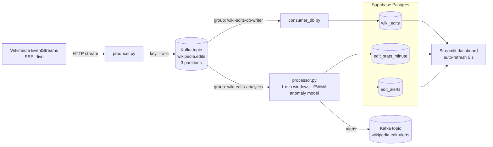
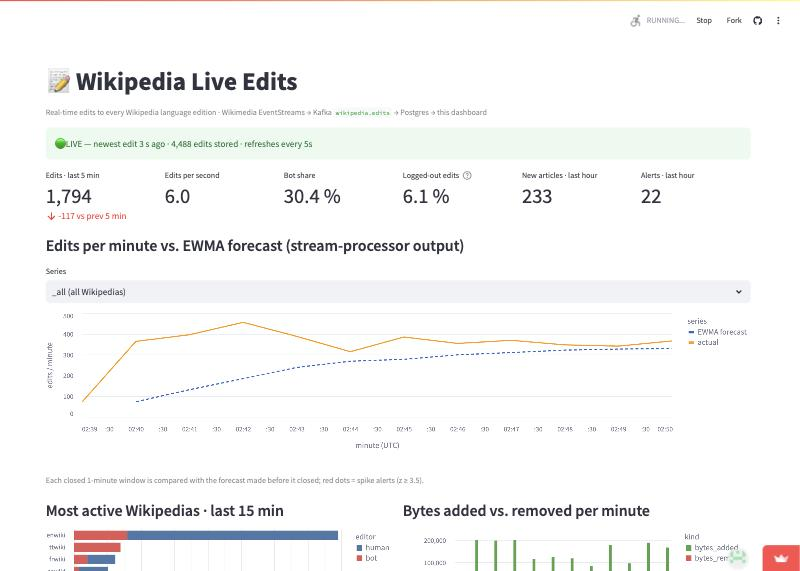
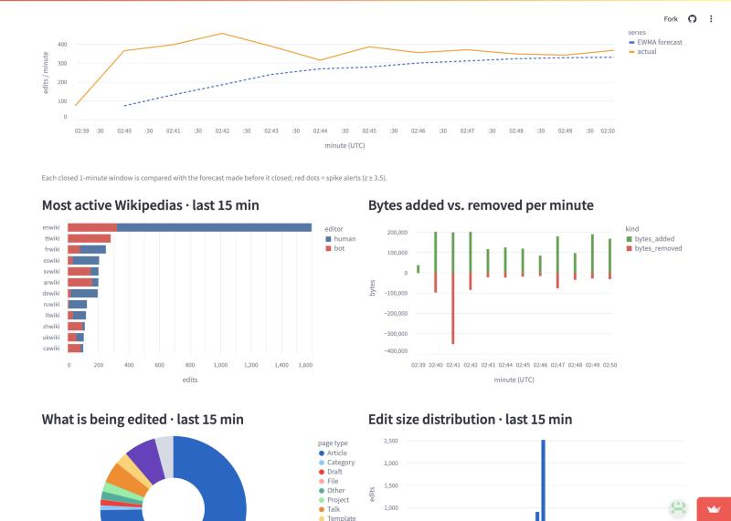
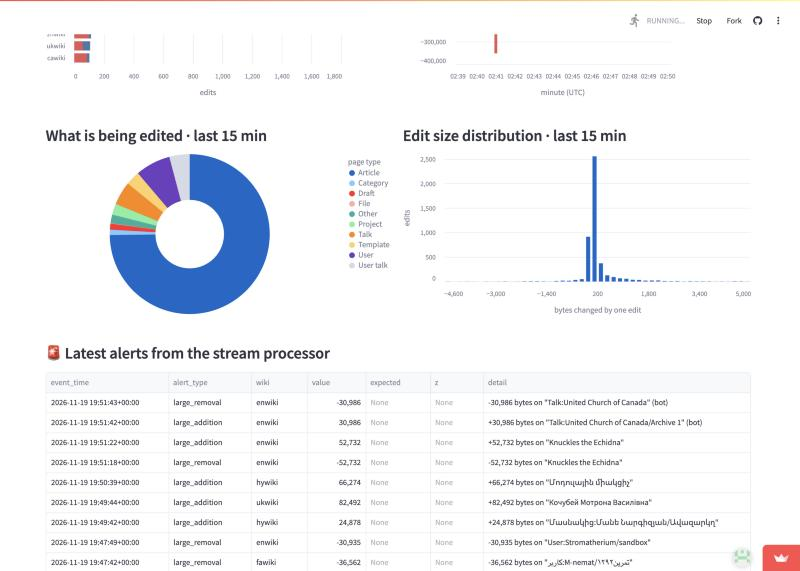
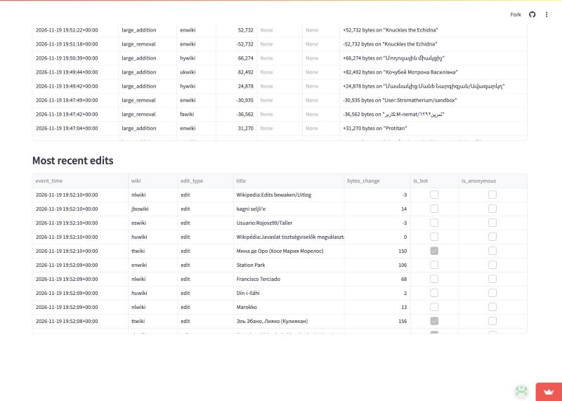

# Wikipedia Live Edits — a real-time Kafka pipeline

**Live dashboard:** https://wiki-live-edits.streamlit.app/

Every few seconds, people and bots around the world edit Wikipedia. This project streams those edits
**live** from Wikimedia's public event feed into **Apache Kafka**, stores them in **Postgres** (Supabase),
runs a **stream processor** that aggregates them per minute and flags anomalies with a sequential
EWMA model, and shows everything on an auto-refreshing **Streamlit** dashboard.

## The story

Wikipedia gets ~5 edits per second across its 300+ language editions. Most of it is routine, but some
of it is not: a bot run that suddenly floods one wiki, someone blanking a 40 kB article, or a burst of
new pages. A moderator can't watch a raw feed that fast — they need **rates, baselines and alerts**.
This pipeline turns the raw firehose into exactly that: how busy each Wikipedia is right now, how much
of it is bots or logged-out editors, how much text is being added vs. removed, and an alert whenever a
wiki's edit rate jumps far above its own recent baseline or a single edit is unusually large.

## Data source

**Real and live:** [Wikimedia EventStreams](https://stream.wikimedia.org/?doc) `recentchange` — a public
Server-Sent-Events feed of every change on every Wikimedia project. No API key is needed (the producer
sends a descriptive `User-Agent`, as Wikimedia asks). The producer keeps edits and page creations on
`*.wikipedia.org` and drops other projects (Commons, Wikidata, …) and log events.

Each Kafka event has 14 fields:

| field | type | example | role |
|---|---|---|---|
| `event_id` | UUID | `1ca23742-ea39-…` | **unique id** (Wikimedia `meta.id`) |
| `event_time` | timestamp | `2026-11-19T18:31:24Z` | **timestamp** |
| `wiki` | text | `enwiki` | **category** (also the message key) |
| `edit_type` | text | `edit` / `new` | **category** |
| `bytes_change` | int | `+776` | **numeric** |
| `rc_id`, `language`, `namespace`, `title`, `is_bot`, `is_minor`, `is_anonymous`, `old_length`, `new_length` | | | context |

`is_anonymous` is true for edits by logged-out users, shown either as an IP address or (since Wikipedia's
2025 change) as a temporary account whose name starts with `~`.

## Architecture



| Component | File | What it does |
|---|---|---|
| Producer | `pipeline/producer.py` | Reads the SSE feed, reconnects with `Last-Event-ID` on drops, filters, reshapes, publishes to `wikipedia.edits`. Idempotent producer (`enable.idempotence`, `acks=all`). |
| Kafka | `docker-compose.yml` | Single-node Kafka 3.9 in KRaft mode; `kafka-init` creates `wikipedia.edits` (3 partitions) and `wikipedia.edit-alerts`. |
| Storage consumer | `pipeline/consumer_db.py` | Consumer group **`wiki-edits-db-writer`**. Batch insert with `ON CONFLICT (event_id) DO NOTHING`; commits Kafka offsets **after** the DB commit → no lost rows, no duplicates on replay. Keeps 6 h of raw events (free-tier friendly). |
| Stream processor | `pipeline/processor.py` | Consumer group **`wiki-edits-analytics`** (independent of the writer — both read every event). See below. |
| Dashboard | `dashboard/app.py` | Streamlit, `st.fragment(run_every="5s")`, reads only from Postgres. |

### Message key

Events are keyed by **`wiki`** (e.g. `enwiki`) because the stream processor's state — per-minute windows
and the EWMA baseline — is kept *per wiki*: Kafka guarantees ordering only within a partition, and the
same key always goes to the same partition, so all edits of one wiki are processed in order by one
consumer while different wikis spread across the 3 partitions.

### Stream processing (part 4) and sequential anomaly detection (extension B)

`processor.py` computes, as events arrive:

1. **1-minute tumbling windows per wiki** (event time, 20 s allowed lateness, watermark = latest event
   time seen) → `edit_stats_minute`: edits, bot edits, logged-out edits, new pages, bytes added, bytes
   removed. A pseudo-wiki `_all` holds the global totals.
2. **EWMA forecast + spike detection** — for each wiki the processor keeps an exponentially weighted
   moving average and variance of *edits per minute* (α = 0.2). When a window closes it compares the
   actual count with the forecast made **before** seeing that window:
   `z = (actual − expected) / max(σ, √expected, 1)`. After a 10-window warm-up, `z ≥ 3.5` with at least
   15 edits raises an `edit_spike` alert. Forecast, z-score and the anomaly flag are stored with each
   window, so the dashboard can plot *actual vs. forecast*. On restart the model state is rebuilt from
   the last hour of `edit_stats_minute`.
3. **Per-event rule** — one edit that adds or removes ≥ 20 000 bytes raises `large_addition` /
   `large_removal`.

Alerts are published to the Kafka topic **`wikipedia.edit-alerts`** *and* written to **`edit_alerts`**.

### Database tables (`db/schema.sql`)

* `wiki_edits` — one row per event, columns match the event fields (+ `ingested_at`).
* `edit_stats_minute` — derived per-wiki/per-minute aggregates + `expected_edits`, `zscore`, `is_anomaly`.
* `edit_alerts` — derived alerts.

## Dashboard

Auto-refreshes every 5 seconds (no reload button). If the producer isn't running it says so and shows
the last captured data instead of an empty page.

* **Summary numbers:** edits in the last 5 min (with change vs. the previous 5 min), edits/second,
  bot share, logged-out share, new articles in the last hour, alerts in the last hour.
* **Charts:** edits/minute vs. EWMA forecast with anomaly markers (derived result; selectable per wiki) ·
  most active Wikipedias, human vs. bot · bytes added vs. removed per minute · page types being edited ·
  edit-size distribution.
* **Tables:** latest alerts from the stream processor, most recent edits.

## Run it

Requirements: Docker Desktop.

```bash
git clone https://github.com/xuechunz38-stack/wiki-stream-pipeline.git
cd wiki-stream-pipeline
```

**Option A — everything local (no account needed):**

```bash
docker compose --profile localdb up -d --build
```

Open http://localhost:8501. Within ~1 minute the first windows close and the charts fill in.

**Option B — cloud database (what the deployed dashboard uses):**

```bash
cp .env.example .env      # then put your Supabase "Session pooler" connection string in .env
docker compose up -d --build
```

Useful commands:

```bash
docker compose logs -f producer processor           # watch events and alerts
docker compose exec kafka /opt/kafka/bin/kafka-consumer-groups.sh --bootstrap-server localhost:9092 --describe --all-groups
docker compose down                                  # stop
```

### Deploying the dashboard (Streamlit Community Cloud)

1. New app → this repo, branch `main`, main file `dashboard/app.py` (the root `requirements.txt` is used).
2. *Advanced settings → Secrets*:
   ```toml
   DATABASE_URL = "postgresql://dashboard_reader.<project-ref>:<password>@aws-0-<region>.pooler.supabase.com:5432/postgres"
   ```
   The dashboard uses a **read-only** role (`db/readonly_role.sql`), so the public app cannot modify data.

No passwords or keys are committed: `.env` and `.streamlit/secrets.toml` are git-ignored; `.env.example`
shows the format.

## Outcome

Results from a run on Nov 19, 2026 (19:39–19:53 UTC), pipeline on a laptop, database on Supabase,
dashboard on Streamlit Community Cloud:

| | |
|---|---|
| Raw Wikimedia changes read by the producer | ~27,000 (all projects) |
| Wikipedia edits published to `wikipedia.edits` | **4,682** (~6 per second), 0 delivery failures |
| Rows in `wiki_edits` (Supabase) | 4,134 after 11.5 min, growing every second |
| Distinct Wikipedias seen | **88** |
| Rows in `edit_stats_minute` | 481 (one per wiki per minute, plus `_all`) |
| Alerts | 22 in the first ~15 min (`large_addition` / `large_removal`) |
| Consumer lag | 0–12 messages per partition for both groups |

**What the data showed**

* About **30 % of all edits are made by bots** and ~6 % by logged-out users; ~230 new articles per hour.
* English Wikipedia dominates (≈1,600 edits in 15 min), followed by a long tail; Tatar Wikipedia (`ttwiki`)
  was almost entirely bot traffic during the run, which the human-vs-bot chart makes obvious.
* The large-edit rule caught real events within seconds, e.g. **−52,732 bytes on "Knuckles the Echidna"
  followed by +52,732 four seconds later** (a page blanking and its revert), a bot archiving 30 kB of
  "Talk:United Church of Canada", and several 25–83 kB additions on Armenian and Ukrainian Wikipedia.
* The EWMA model started from a partial first minute (73 edits), so the forecast began low and converged
  to the real rate (~330 vs. ~340–390 edits/min) within ~8 windows; z-scores then stayed below 1, so no
  false `edit_spike` alerts were raised for the global series. The 10-window warm-up exists exactly
  for this cold start.

**Screenshots of the deployed dashboard**






Kafka evidence (topics, both consumer groups with offsets/lag, keyed messages, alert topic) is in
[`docs/kafka_evidence.txt`](docs/kafka_evidence.txt); service logs in [`docs/pipeline_logs.txt`](docs/pipeline_logs.txt).

**Limitations / next steps:** single Kafka broker (no replication); the processor keeps window state in
memory (a crash loses the current minute — Flink or Kafka Streams would checkpoint it); raw events are
kept 6 h to stay inside the Supabase free tier.

## Repository layout

```
├── docker-compose.yml        Kafka (KRaft) + topic init + producer + 2 consumers + dashboard (+ optional local Postgres)
├── pipeline/
│   ├── producer.py           Wikimedia SSE -> wikipedia.edits
│   ├── consumer_db.py        wikipedia.edits -> wiki_edits         (group wiki-edits-db-writer)
│   ├── processor.py          windows + EWMA anomalies -> edit_stats_minute, edit_alerts, wikipedia.edit-alerts
│   ├── common.py             config, DB connection, schema bootstrap
│   ├── Dockerfile, requirements.txt
├── dashboard/app.py          Streamlit dashboard (+ Dockerfile, requirements.txt)
├── db/schema.sql             tables;  db/readonly_role.sql  read-only role for the dashboard
├── requirements.txt          dashboard dependencies (used by Streamlit Cloud)
└── .env.example
```
